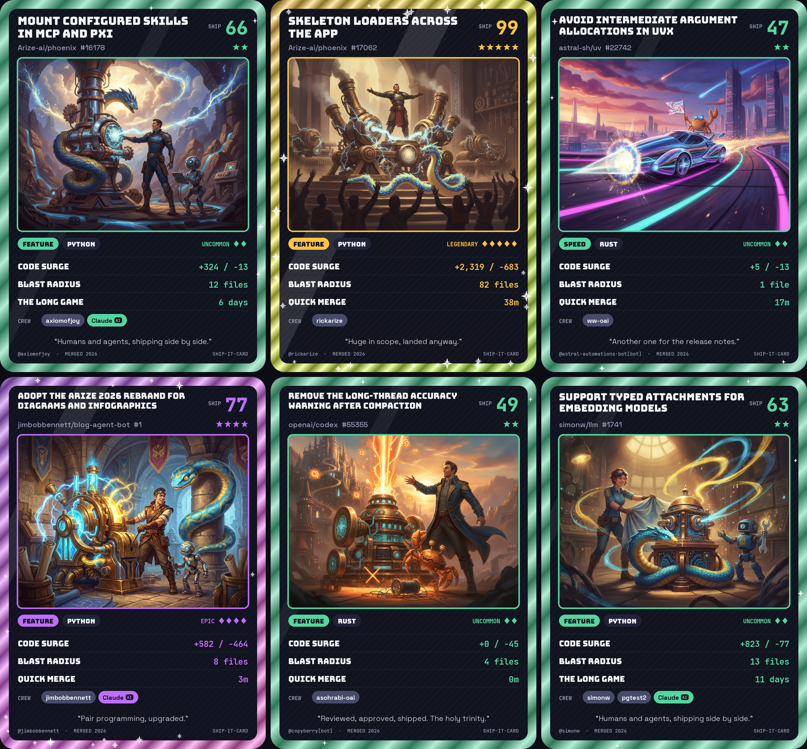
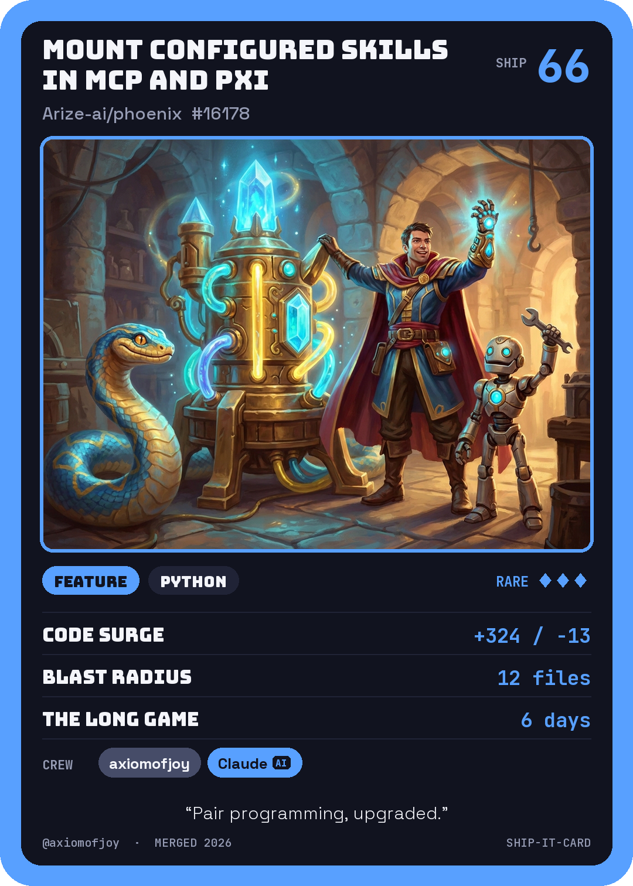
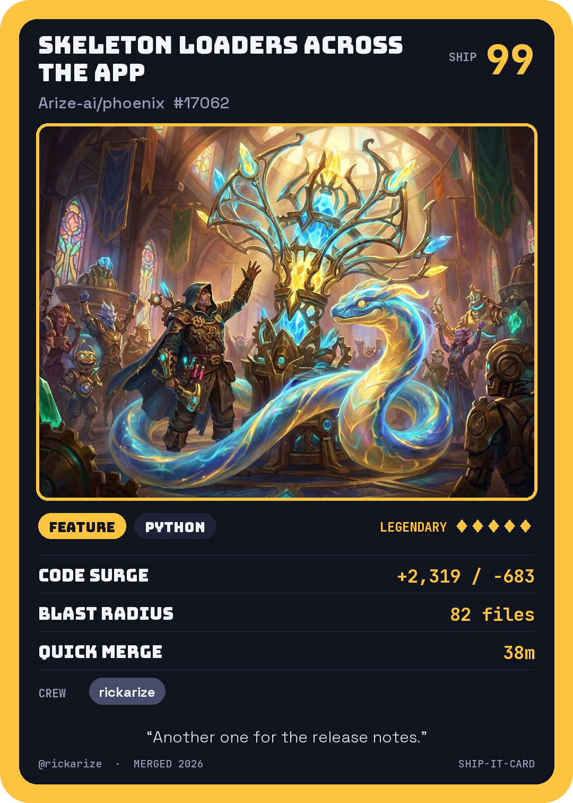
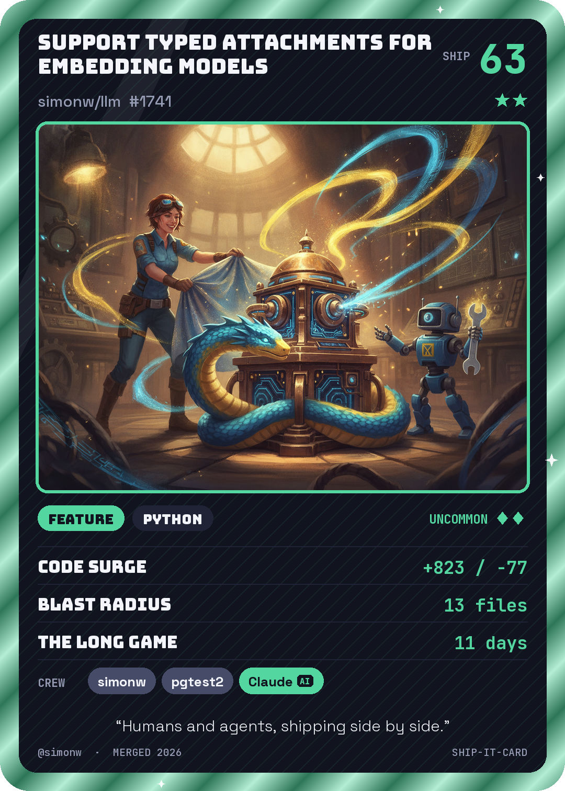
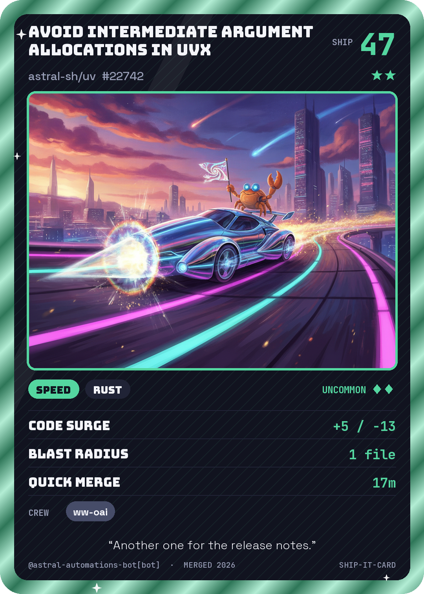
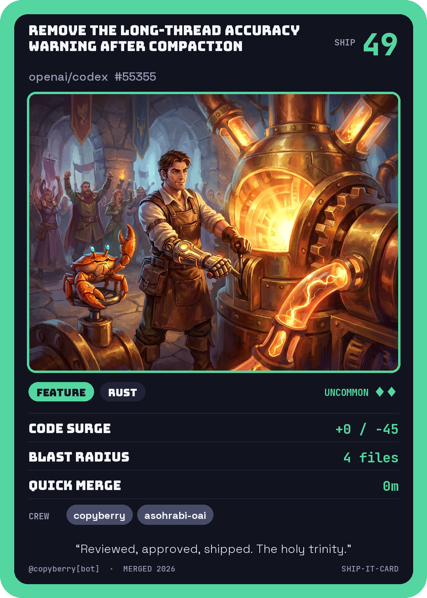
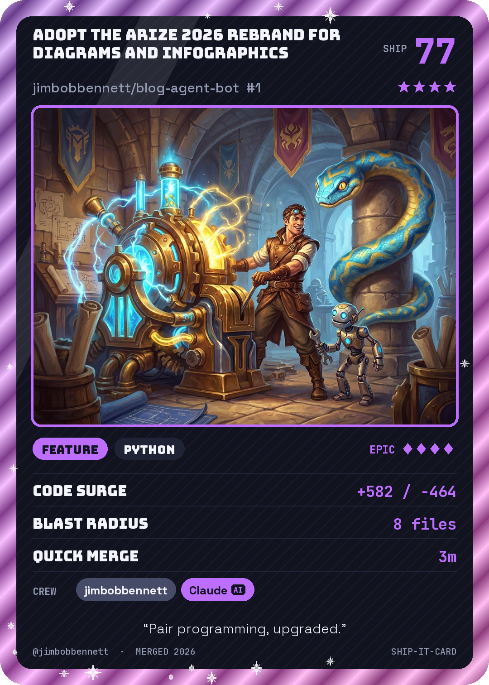

# ship-it-card

Every merged pull request deserves a trading card.

Paste a GitHub PR URL and ship-it-card turns it into a collectible card: a ship score,
a rarity, three "abilities" pulled from the diff, the crew who worked on it (humans **and**
coding agents, detected from commit authors and `Co-Authored-By` trailers), and original
artwork generated by Gemini.



This repo is also the target app for [software-factory](https://github.com/jimbobbennett/software-factory),
a small demo where Claude agents pick up issues here, write the code, review each other's
PRs and ship. Most of the code and most of the PRs were written by agents; see
[Built by a software factory](#built-by-a-software-factory) below.

## Gallery

<table>
  <tr>
    <td align="center">
      <a href="https://github.com/Arize-ai/phoenix/pull/16178"></a><br>
      <a href="https://github.com/Arize-ai/phoenix/pull/16178">Arize-ai/phoenix#16178</a>
    </td>
    <td align="center">
      <a href="https://github.com/Arize-ai/phoenix/pull/17062"></a><br>
      <a href="https://github.com/Arize-ai/phoenix/pull/17062">Arize-ai/phoenix#17062</a>
    </td>
    <td align="center">
      <a href="https://github.com/simonw/llm/pull/1741"></a><br>
      <a href="https://github.com/simonw/llm/pull/1741">simonw/llm#1741</a>
    </td>
  </tr>
  <tr>
    <td align="center">
      <a href="https://github.com/astral-sh/uv/pull/22742"></a><br>
      <a href="https://github.com/astral-sh/uv/pull/22742">astral-sh/uv#22742</a>
    </td>
    <td align="center">
      <a href="https://github.com/openai/codex/pull/55355"></a><br>
      <a href="https://github.com/openai/codex/pull/55355">openai/codex#55355</a>
    </td>
    <td align="center">
      <a href="https://github.com/jimbobbennett/blog-agent-bot/pull/1"></a><br>
      <a href="https://github.com/jimbobbennett/blog-agent-bot/pull/1">jimbobbennett/blog-agent-bot#1</a>
    </td>
  </tr>
</table>

## Requirements

- Python 3.11 or later and [uv](https://docs.astral.sh/uv/)
- A [Gemini API key](https://aistudio.google.com/apikey) for the artwork (optional: without
  one you get procedural art)
- A GitHub token (optional: raises the GitHub API rate limit from 60 to 5,000 requests an
  hour, and is needed for private repos)

## Quick start

```bash
git clone https://github.com/jimbobbennett/ship-it-card.git
cd ship-it-card
uv sync
cp .env.example .env       # add GEMINI_API_KEY (and optionally GITHUB_TOKEN)
```

### CLI

```bash
uv run python -m shipit https://github.com/simonw/llm/pull/1741 -o card.png
uv run python -m shipit https://github.com/simonw/llm/pull/1741 --json   # stats as JSON, no art/PNG
uv run python -m shipit --version                                        # print the installed version
```

| Option | What it does |
| --- | --- |
| `-o`, `--out PATH` | Output PNG (default `<repo>-<n>.png`) |
| `--no-gemini` | Use procedural art instead of Gemini |
| `--show-bots` | Include CI bots in the crew |
| `--host HOST` | GitHub Enterprise Server hostname |
| `--flavor TEXT` | Custom flavour text (max 80 characters) |
| `--style STYLE` | `pixel`, `anime`, `watercolour` or `painterly` art |
| `--token TOKEN` | GitHub token for a private repo, for this run only |
| `--json` | Print the card stats as JSON instead of rendering a PNG |

### Web app

```bash
uv run uvicorn shipit.web:app --reload     # http://localhost:8000
```

| Endpoint | What it returns |
| --- | --- |
| `GET /` | The form, plus a gallery of the 20 most recent cards (in memory, reset on restart) |
| `GET /card?url=<pr-url>` | The card page, with a score breakdown and share buttons |
| `POST /card` | The same, for form submissions (needed for private-repo tokens) |
| `GET /card.png?url=<pr-url>` | The card as a PNG |
| `GET /badge.svg?url=<pr-url>` | A small README badge (see [README badge](#readme-badge)) |

`/card` and `/card.png` also accept `show_bots`, `flavor`, `style` and `host` query parameters,
described below.

## Features

### The crew

CI bots such as `github-actions[bot]`, `dependabot[bot]` and `codecov[bot]` are left out of
the crew by default; coding agents (Claude, Copilot, ...) always stay. Pass `--show-bots` on
the CLI, or `show_bots=true` on the web app (`/card?url=...&show_bots=true` and
`/card.png?url=...&show_bots=true`), to include the bots; they get their own distinct chip colour and a small `BOT` tag, so humans,
AI agents and bots are easy to tell apart.

### First-time contributors

When the PR author's GitHub `author_association` is `FIRST_TIME_CONTRIBUTOR` or `FIRST_TIMER`,
their crew chip gets a small drawn 🌱 seedling. Only the PR author can be detected. In `--json`
output every crew entry has a `first_timer` boolean.

### Sharing

The `/card` page has a **Download PNG** button and a **Copy link** button (copies the shareable page URL), plus **Share on X** and **Share on LinkedIn** links (prefilled with your score and the page URL). Copy link and the share links are not shown for tokened cards.

### Custom flavour text

Pass `--flavor "Ship happens"` on the CLI (PNG and `--json` output), or `flavor=Ship%20happens`
on the web app (`/card?url=...&flavor=...` and `/card.png?url=...&flavor=...`), to replace the
generated flavour line. Maximum 80 characters; longer text is rejected.

### Art styles

Pass `--style pixel|anime|watercolour|painterly` on the CLI, or `style=pixel` on the web app
(`/card?url=...&style=...` and `/card.png?url=...&style=...`), to change the style of the Gemini
art. With no style the card keeps the current look. Any other value is rejected (web: HTTP 400;
CLI: usage error). Styled cards are cached separately. A styled request never falls back to the
procedural art: without `GEMINI_API_KEY`, with `--no-gemini`, or if Gemini fails, it errors instead
(CLI: exit code 1 with a message; web: HTTP 503).

### Artwork without Gemini

Without `GEMINI_API_KEY` (or with `--no-gemini`) an unstyled card still renders, with procedural
artwork instead. Generated art is cached in `.cache/art/`, keyed by model and prompt. The PR
description also steers the art prompt; it is sanitised and truncated to 300 characters first.

### Private repos (your own token)

Pass `--token TOKEN` on the CLI (PNG and `--json`), or fill in the optional password field on the
web form, to make a card for a PR in a private repo you can access. The token overrides
`GITHUB_TOKEN`/`GHE_TOKEN` for that one request; blank means unset. It is never cached, logged,
printed, or put in a URL: the web form submits by POST, the card is inlined as a `data:` image,
and tokened cards are never cached, shown in the gallery, or given share/OG links. Tokens are
not accepted as query parameters on `GET` endpoints. On the web app a token is only sent to
github.com or a host in `SHIPIT_ALLOWED_HOSTS`. Prefer a fine-grained, read-only token.

### GitHub Enterprise Server

Pass `--host ghe.example.com` on the CLI, or `host=ghe.example.com` on the web app
(`/card?url=...&host=...` and `/card.png?url=...&host=...`), to fetch a PR from
`https://<host>/api/v3`. The PR URL must be on that same host, and the host must be a bare
hostname with an optional port. `GITHUB_TOKEN` is never sent to a custom host; set
`GHE_TOKEN` to authenticate to it (otherwise requests are unauthenticated).

The web app only accepts hosts listed in the `SHIPIT_ALLOWED_HOSTS` env var
(comma-separated, e.g. `ghe.example.com,ghe2.example.com:8443`). If it is unset, every
`host=` is rejected with a 400. This prevents SSRF and `GHE_TOKEN` leakage to arbitrary
hosts. The CLI is unaffected.
Ports must be 1 to 65535.

### Card cache

`/card.png` keeps rendered PNGs on disk so a restart doesn't re-fetch from GitHub or
regenerate art. The directory is `SHIPIT_CARD_CACHE_DIR` (default `.cache/cards`); files are
named by a SHA-256 of the PR URL, `show_bots` and host. There is no expiry: delete the
directory to refresh. `/card` and `/badge.svg` still use the in-memory cache only.

### Rate limit

Each client IP may generate 30 cards per hour (a sliding window). Only real generations count,
that is a miss in both the in-memory and the `/card.png` disk cache, so cached cards and the
home-page gallery are free. It covers `GET`/`POST /card`, `/card.png` and `/badge.svg`; over the
limit they return `429` with a friendly message and a `Retry-After` header (seconds). Requests
rejected for invalid input don't count.

| Variable | Default | Meaning |
| --- | --- | --- |
| `SHIPIT_RATE_LIMIT` | `30` | Cards per window per IP; `0` disables the limit |
| `SHIPIT_RATE_WINDOW` | `3600` | Window length in seconds |
| `SHIPIT_TRUSTED_PROXY_HOPS` | `0` | Number of trusted reverse proxies in front of the app |

Invalid values fall back to the defaults. **Behind a reverse proxy** every request appears to
come from the proxy's IP unless you set `SHIPIT_TRUSTED_PROXY_HOPS=N`; the app then uses the Nth
entry from the right of `X-Forwarded-For` (the address your outermost trusted proxy saw). Leave
it at `0` when the app is exposed directly: the header is ignored, so clients can't spoof it.
Only set it if your proxy really appends to `X-Forwarded-For`.

Counters are per process and kept in memory: they reset on restart and aren't shared between
workers.

## README badge

`GET /badge.svg?url=<pr-url>` returns a small shields.io-style SVG badge. Embed it in a README:

```markdown

```

The left part shows `<repo> · <PR title>` (the title is truncated with an ellipsis); the
right part shows `<Rarity> <score>`, filled with the rarity colour: Common `#a8b2c1`,
Uncommon `#54d6a0`, Rare `#58a0ff`, Epic `#be6eff`, Legendary `#ffc440`. The response is
`image/svg+xml` with `Cache-Control: public, max-age=600`.

## How a card is scored

| Field | Where it comes from |
|---|---|
| Ship score (1 to 99) | lines changed (log scale), distinct reviewers, commits, and a bonus for merging within a day. The `/card` page shows a table of how each factor contributed to the total |
| Rarity | Common < 40 ≤ Uncommon < 72 ≤ Rare < 75 ≤ Epic < 88 ≤ Legendary |
| Type | conventional-commit prefix (`feat:`, `fix:`, `docs:` ...) or PR labels |
| Crew | PR author, commit authors and `Co-Authored-By` trailers; Claude, Codex, Copilot, Cursor, Devin, Windsurf, Kiro, OpenHands, Factory, Amazon Q and friends get an **AI** badge |
| Art | Gemini (`gemini-2.5-flash-image` by default, `SHIPIT_IMAGE_MODEL` to change) from the card type, language and a sanitised title |

## Configuration

All settings are environment variables. Copy `.env.example` to `.env` to get started.

| Variable | Default | Meaning |
| --- | --- | --- |
| `GEMINI_API_KEY` | unset | Gemini key for the artwork; without it cards use procedural art |
| `SHIPIT_IMAGE_MODEL` | `gemini-2.5-flash-image` | Gemini image model |
| `GITHUB_TOKEN` | unset | Token for github.com API calls |
| `GHE_TOKEN` | unset | Token for GitHub Enterprise Server hosts (`GITHUB_TOKEN` is never sent there) |
| `SHIPIT_ALLOWED_HOSTS` | unset | Comma-separated GHE hosts the web app may call; unset rejects every `host=` |
| `SHIPIT_CACHE` | `.cache` | Root of the generated-art cache (`<root>/art`) |
| `SHIPIT_CARD_CACHE_DIR` | `.cache/cards` | Where `/card.png` keeps rendered cards |
| `SHIPIT_RATE_LIMIT` | `30` | Cards per window per IP; `0` disables the limit |
| `SHIPIT_RATE_WINDOW` | `3600` | Rate-limit window in seconds |
| `SHIPIT_TRUSTED_PROXY_HOPS` | `0` | Trusted reverse proxies in front of the web app |

## Project layout

```
shipit/
  __main__.py   CLI entry point (python -m shipit)
  core.py       one call from PR URL to finished card, shared by the CLI and web app
  github.py     GitHub and GitHub Enterprise API client
  stats.py      turn raw PR data into the score, rarity, abilities, crew and flavour text
  art.py        Gemini artwork, procedural fallback and the art cache
  card.py       Pillow card renderer
  web.py        FastAPI app: pages, PNG, badge, caches and rate limit
  fonts/        bundled fonts and their licences
tests/          pytest suite (GitHub calls are mocked with fixtures)
examples/       example cards and the script that regenerates them
```

## Develop

```bash
uv sync
uv run pytest -q
uv run ruff check . && uv run ruff format --check .
PYTHONPATH=. uv run python examples/make_examples.py   # regenerate the example cards (needs GEMINI_API_KEY)
```

CI runs ruff and pytest on every pull request (`.github/workflows/ci.yml`).

## Built by a software factory

Since v0.1, most changes to this app have come from
[software-factory](https://github.com/jimbobbennett/software-factory): an issue goes in, Claude
agents write a spec, build the change, fix CI, review it from three angles and route it to
auto-merge or a review gate, then cut a release. That is why most PRs here were opened by
the factory and list Claude in the crew. The factory's traces, evals and prompt experiments live in Arize AX.

## License

[MIT](LICENSE). The bundled fonts (Bungee, Space Grotesk and JetBrains Mono) are under the
SIL Open Font License; see `shipit/fonts/`.
